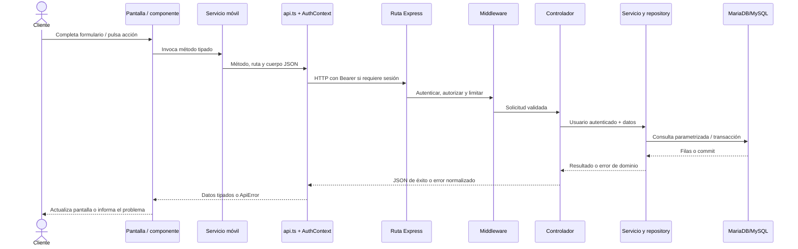

# Guía de arquitectura de PetCare

> **Avance por módulos:** se documentaron la estructura/arranque y los recorridos iniciales de autenticación, alta de mascotas y solicitud de turnos. Para el catálogo archivo por archivo y el progreso de funciones, consulta la [guía de archivos](GUIA_ARCHIVOS_PETCARE.md) y la [tabla de cobertura](COBERTURA_DOCUMENTACION_PETCARE.md). Los módulos todavía no analizados en profundidad se identifican como pendientes.

## 1. Qué es PetCare

PetCare es un sistema web y móvil para coordinar atención y servicios de una clínica veterinaria. En el repositorio hay dos aplicaciones: `mobile/` es el cliente de interfaz, creado con Expo, React Native y Expo Router; `backend/` es una API HTTP con Express y TypeScript. La API organiza sus capacidades en módulos y utiliza MariaDB/MySQL para persistencia, según la configuración y documentación del proyecto.

La palabra `mobile` es el nombre de la carpeta y paquete del frontend: no significa que sea solo Android. Expo Router permite generar la experiencia web y compilar la aplicación nativa Android desde el mismo código de interfaz, aunque ciertos comportamientos dependen de plataforma y configuración nativa.

## 2. Estructura de alto nivel

```text
PetCare-SistemaVeterinario/
├── README.md                 # Descripción y guía de desarrollo general
├── mobile/                   # Frontend Expo para web y Android
│   ├── src/app/               # Rutas y layouts de Expo Router
│   ├── src/components/        # Interfaz reutilizable y pantallas compuestas
│   ├── src/contexts/          # Estado compartido de la aplicación
│   ├── src/hooks/             # Lógica reusable de React
│   ├── src/services/          # API y servicios del frontend
│   ├── src/utils/             # Validaciones y reglas auxiliares del cliente
│   ├── app.json               # Configuración Expo y capacidades nativas
│   ├── eas.json               # Perfiles de build EAS
│   └── vercel.json            # Exportación y comportamiento de hosting web
├── backend/                  # API Node.js, Express y TypeScript
│   ├── src/app.ts             # Construcción de Express y montaje HTTP
│   ├── src/server.ts          # Listener local y cierre ordenado
│   ├── src/routes/            # Composición de endpoints por dominio
│   ├── src/controllers/       # Adaptación HTTP a los casos de uso
│   ├── src/services/          # Reglas/casos de uso e integraciones
│   ├── src/repositories/      # Persistencia por dominio
│   ├── src/middlewares/        # Capas transversales de Express
│   ├── src/validators/         # Validación de entradas
│   ├── src/config/             # Entorno y recursos externos
│   └── src/database/           # Herramientas SQL y scripts de esquema
└── docs/                       # Guías de estudio generadas por etapas
```

Los directorios omitidos del árbol contienen además tipos, constantes, utilidades, configuración y recursos de interfaz. El inventario completo por carpetas está en [INVENTARIO_Y_ORDEN_DOCUMENTACION.md](INVENTARIO_Y_ORDEN_DOCUMENTACION.md).

## 3. Módulo 1: cómo se inicia el sistema

### Frontend: entrada y marco global

El campo `main` de `mobile/package.json` apunta a `expo-router/entry`. Expo Router descubre los archivos de `mobile/src/app/` y usa `mobile/src/app/_layout.tsx` como layout raíz. Ese layout instala los proveedores de área segura, tema, feedback y autenticación, define la pila y sus guardas, y agrega navegación global y el puente de notificaciones.

La ruta `mobile/src/app/index.tsx` es la entrada `/`. Lee el usuario mediante `useAuth()` y entrega la decisión a `EntryRedirect`. Así la ruta delega el destino inicial y la sesión no se vuelve a implementar dentro de cada pantalla. La lógica de destino concreta está en `mobile/src/components/layout/EntryRedirect.tsx` y la composición de sesión en `mobile/src/contexts/AuthContext.tsx`; se estudiarán en el módulo de navegación/estado.

En el layout, `ThemedNavigation` configura rutas protegidas según el usuario, rol y capacidades. Es una protección de navegación para controlar la experiencia visible. La autorización final de operaciones y datos debe estudiarse en el backend y no se deduce solo de una guarda de pantalla.

### Backend: aplicación HTTP y listener

`backend/src/app.ts` construye y exporta `app`, una instancia de Express. En ella se configuran proxy, CORS, cabeceras de seguridad, límites de cuerpo para algunas cargas, parseo JSON general, ruta de tareas programadas, acceso a medios y el router principal. Los handlers de rutas inexistentes y errores se agregan al final para recibir solicitudes que no atendió una ruta previa o fallos propagados.

`backend/src/server.ts` importa esa instancia y abre un listener HTTP en el puerto de `env.port`. En ejecución local también revisa reservas vencidas al iniciar y mediante un temporizador. Al recibir `SIGINT` o `SIGTERM`, detiene el temporizador, cierra el servidor y libera el pool de base de datos. Este archivo es el arranque indicado por el script `npm run dev` y el resultado compilado por `npm run start`.

El default export de `app.ts` está preparado para que Vercel pueda importar la aplicación Express sin que `server.ts` abra un listener propio. La configuración exacta de despliegue se documentará en el módulo de operaciones.

### Cómo se enruta una solicitud

`app.ts` monta `apiRouter` bajo `/api`. `backend/src/routes/index.ts` agrupa routers secundarios bajo prefijos como `/auth`, `/client`, `/admin`, `/clinic`, `/vet`, `/notifications`, `/settings` y `/media`. También conecta las rutas de salud. Los controladores y middlewares específicos se encuentran detrás de cada router; los detalles se explicarán por dominio para no confundir el mapa de URL con la lógica de negocio.

```mermaid
flowchart TD
  A[Expo inicia expo-router/entry] --> B[Layout raíz _layout.tsx]
  B --> C[Proveedores: sesión, tema, feedback]
  C --> D[Ruta raíz index.tsx]
  D --> E[EntryRedirect decide destino]
  E --> F[Pantalla según sesión y rol]

  G[Cliente web o Android] --> H[API HTTP]
  H --> I[backend/src/app.ts: middleware]
  I --> J[/api router]
  J --> K[routes/index.ts]
  K --> L[router de dominio]
  L --> M[controlador / middleware]
  M --> N[servicio y repositorio]

  O[server.ts en ejecución Node local] --> I
  P[Vercel] --> I
```

## 4. Tecnologías identificadas en este módulo

| Tecnología | Uso que se observa |
|---|---|
| TypeScript | Tipado estático del cliente y servidor. |
| Expo SDK / React Native | Base del frontend multiplataforma. |
| Expo Router | Convierte archivos bajo `src/app/` en rutas y layouts. |
| Node.js | Entorno de ejecución del backend. |
| Express 5 | Composición HTTP, middlewares y routers del backend. |
| Vercel | Configuración de hosting/export web y ejecución del backend según sus manifiestos y README. |
| EAS | Perfiles de compilación Android definidos en `mobile/eas.json`. |

Las dependencias específicas de autenticación, correo, SQL, OAuth, almacenamiento y demás dominios se documentarán en sus módulos. La configuración que dependa de valores privados se explicará sin exponerlos.

## 5. Archivos clave de esta etapa

- `mobile/package.json`: dependencias, scripts y punto principal `expo-router/entry`.
- `mobile/src/app/_layout.tsx`: proveedores globales, pila y guardas de navegación.
- `mobile/src/app/index.tsx`: resolución de entrada con estado de sesión.
- `backend/src/app.ts`: composición de Express, middleware y montaje de routers.
- `backend/src/routes/index.ts`: prefijos y routers principales de la API.
- `backend/src/server.ts`: listener local, tarea periódica y cierre del pool SQL.
- `backend/package.json`: comandos para desarrollo, build, comprobaciones y operación SQL.

## 6. Estado y siguientes módulos

Esta guía ya presenta la arquitectura general y recorridos representativos. La documentación por función de todos los módulos sigue progresando; consulta [INVENTARIO_Y_ORDEN_DOCUMENTACION.md](INVENTARIO_Y_ORDEN_DOCUMENTACION.md) para el orden y [COBERTURA_DOCUMENTACION_PETCARE.md](COBERTURA_DOCUMENTACION_PETCARE.md) para el estado por archivo. El siguiente lote funcional es navegación y áreas por rol, seguido por los componentes, hooks y servicios restantes.

## 7. Capas del frontend y backend

### Frontend

- `mobile/src/app/` representa rutas URL/pantallas. Los archivos `_layout.tsx` aplican layouts y `Stack.Protected` restringe rutas según el estado local de sesión, rol y capacidades.
- `mobile/src/components/` contiene UI común y pantallas compuestas. Las pantallas grandes suelen delegar en formularios o piezas más pequeñas.
- `mobile/src/contexts/` mantiene estado transversal. `AuthContext` ofrece sesión y métodos de autenticación; los hooks como `useAuth` consumen ese contexto.
- `mobile/src/hooks/` conecta servicios y estado de React para que pantallas compartan consultas, acciones asíncronas, tema y navegación.
- `mobile/src/services/` construye llamadas a `/api`; `api.ts` resuelve URL, timeout, parseo de respuesta y errores públicos. El cliente no define el permiso final.
- `mobile/src/utils/` contiene reglas de validación o presentación que ayudan a la experiencia de usuario. El servidor vuelve a validar lo que necesita proteger.

### Backend

El recorrido habitual es `routes → middleware → controller → service → repository → database`. No todos los endpoints tienen necesariamente un archivo distinto por capa: algunos controladores parametrizados construyen handlers genéricos y algunos servicios despachan por una operación discriminada.

- Las rutas fijan método HTTP, prefijo y middlewares requeridos.
- Los middlewares validan sesión, rol, permisos, alcance personal y límites de frecuencia.
- Los controladores traducen `Request` y `Response` al contrato de servicio y convierten resultados a JSON.
- Los servicios coordinan validación, políticas y llamadas a repositorios/integraciones.
- Los repositorios construyen consultas SQL y transacciones usando el pool configurado.
- Los validadores convierten datos desconocidos en entradas tipadas o emiten errores controlados.
- El middleware de error evita exponer detalles internos de SQL/stack al cliente.

## 8. Comunicación con la API

`mobile/src/services/api.ts` es el transporte HTTP común; los servicios del dominio llaman rutas de `/api`. El contexto de autenticación añade el access token Bearer a solicitudes protegidas. El backend monta `apiRouter` bajo `/api` en `backend/src/app.ts`; `backend/src/routes/index.ts` asocia prefijos con routers del dominio. Las lecturas del cliente migradas usan POST con filtros JSON, como `POST /api/client/pets/query`; no se debe asumir que una lectura acepta GET.



## 9. Recorrido concreto: iniciar sesión

1. `mobile/src/app/login.tsx` muestra el flujo de acceso mediante formularios y componentes.
2. El formulario termina llamando a `signIn` expuesto por `AuthContext`.
3. `mobile/src/services/auth.service.ts` envía `POST /auth/login` con email normalizado y contraseña; valida la forma del objeto de sesión recibido.
4. `backend/src/routes/auth.routes.ts` aplica rate limit y entrega la solicitud al handler `login`.
5. `backend/src/controllers/auth.controller.ts` delega en `loginUser` y pasa fallos al middleware Express.
6. `backend/src/services/auth.service.ts` valida entrada, configura JWT, busca usuario, compara bcrypt y comprueba si está activo, verificado y si debe cambiar contraseña.
7. `sessionForUser` crea la sesión; `AuthContext.acceptSession` consulta después `POST /auth/me`, persiste la sesión con `session-store` y actualiza el contexto. El servidor es la fuente del rol/permisos.
8. Si el correo no está verificado, el servicio devuelve el desafío de verificación junto al error controlado; el contexto prepara el modal en vez de aceptar una sesión.

El backend vuelve a consultar la cuenta al autenticar peticiones protegidas (`backend/src/middlewares/auth.middleware.ts`), por lo que la UI no basta como control de seguridad.

## 10. Recorrido concreto: registrar una mascota

1. La ruta `mobile/src/app/client/pets/new.tsx` presenta `PetEditor` de `mobile/src/components/client/PetEditor.tsx`.
2. `PetEditor` carga `petCatalog`, almacena valores en estado, valida nombre, especie, sexo, fecha, peso y microchip, y usa `ImageUploadField` para la imagen.
3. `useClient` crea el servicio con la función autenticada `request`. `mobile/src/services/client.service.ts` envía `POST /client/pets` con campos del formulario.
4. `backend/src/routes/client.routes.ts` monta `/pets` tras `authenticate` y `requirePersonalAccess`. `backend/src/app.ts` procesa esa carga JSON con límite especial después de aplicar autenticación y rate limit.
5. `client.controller.ts` obtiene el owner desde `response.locals.authenticatedUser`, nunca del body. `client.service.ts` ejecuta `petInput`, verifica la referencia de foto y llama al repository.
6. `backend/src/repositories/client.repository.ts` valida que especie/raza existan y pertenezcan entre sí; guarda mascota y detalles dentro de una transacción y devuelve el registro persistido.
7. El controlador serializa `{ success: true, data }`; el cliente actualiza el estado de envío y navega al detalle solo cuando recibe el identificador guardado. Los errores se mantienen en el formulario vía `useAsyncAction`.

## 11. Recorrido concreto: pedir un turno

1. `mobile/src/app/client/appointments/request.tsx` carga mascotas y catálogo, y ofrece pasos para mascota, servicio, profesional, fecha/horario y confirmación.
2. Al seleccionar un servicio, consulta slots con `POST /client/appointments/slots`; la lista viene de `clinic.repository.slots`, que filtra slots futuros que no se solapan con turnos activos.
3. Al confirmar, `client.service.ts` manda únicamente `petId` y `slotId` a `POST /client/appointments`. El servidor deriva dueño de la sesión; servicio y profesional se obtienen del slot guardado.
4. `client.routes.ts` requiere autenticación y acceso personal. `client.controller.ts` pasa el actor autenticado y `client.service.ts` valida la forma del body/IDs.
5. `client.repository.createAppointment` delega en `clinic.repository.requestAppointment`. En transacción se bloquea la mascota que pertenece al usuario, se bloquea al profesional para serializar solicitudes concurrentes y se recalcula disponibilidad.
6. Si el slot dejó de estar disponible, responde error `SLOT_UNAVAILABLE`; si sigue libre, inserta estado `REQUESTED`, crea notificación para cliente y profesional y devuelve `{ id, status }`.
7. La pantalla guarda la respuesta y muestra la confirmación correspondiente. La clínica confirma o cambia el turno desde las rutas de `clinic` conforme a rol y permisos.

## 12. Base de datos y errores

`backend/src/config/database.ts` construye el pool `mysql2/promise` con valores leídos por `config/env.ts`. Los repositorios usan consultas parametrizadas; las operaciones que requieren atomicidad abren transacciones y hacen commit o rollback. Las herramientas bajo `backend/src/database/` son scripts separados: algunas auditan/leen y otras alteran esquema o datos. El arranque normal de la API no aplica migraciones. El SQL canónico para instalar una base nueva no está completo en este checkout, según `backend/README.md`.

Los errores de negocio se crean con `AppError`, recorren `next(error)` y terminan en `backend/src/middlewares/error.middleware.ts`. La respuesta pública conserva un código/mensaje apto para usuario; el frontend `api.ts` los transforma en `ApiError` y mapas de mensajes presentables.

## 13. Sesión, roles y permisos

El backend emite access token Bearer y refresh token. El frontend guarda la sesión mediante `session-store.ts` (SecureStore nativo y sessionStorage web, con implementación separada por plataforma). En el arranque, AuthContext intenta restaurar la sesión, puede renovarla y consulta `/auth/me`. La renovación concurrente se comparte para no reutilizar el mismo refresh token simultáneamente.

`authenticate` verifica token, consulta de nuevo al usuario activo/verificado, compara versión/familia de sesión y carga rol y permisos efectivos. Luego las rutas agregan `requireRole`, `requirePermission`, `requireAnyPermission` o control de acceso personal/ownership. La guarda de navegación móvil controla qué pantalla se muestra; la API vuelve a autorizar cada operación. Las reglas de cada dominio se deben consultar en los middlewares y repositories, no inferir únicamente de los nombres de rol.

## 14. Integraciones, web y Android

- **Correo:** SMTP implementado en `backend/src/config/mail.ts` y `services/mail.service.ts`, usado por verificación, invitaciones y recuperación.
- **OAuth:** providers configurables Google/Facebook/X se gestionan en el backend; la app inicia el flujo, devuelve con ticket y lo intercambia por sesión. El callback nativo usa scheme `petcare`; las credenciales no se incluyen en el bundle.
- **Fotos/archivos:** servicios de backend admiten almacenamiento configurado Cloudinary o S3 compatible. La interfaz prepara/sube imagen y usa referencias que el backend valida; el detalle varía según el tipo de archivo.
- **Notificaciones:** centro interno almacenado por API; no hay push del sistema operativo. Un endpoint de cron procesa recordatorios y correo cuando se invoca con credencial de cron.
- **Web:** Expo Router exporta a web y Vercel sirve `mobile/vercel.json` con rewrite SPA, encabezados y API URL de build.
- **Android:** `mobile/app.json` define scheme, package, icono y plugins nativos. EAS usa perfiles en `mobile/eas.json`; una modificación nativa requiere build nuevo. El uso de SecureStore y retorno OAuth nativo difiere del navegador web.

## 15. Despliegue

El README describe Vercel con `mobile/` y `backend/` como Root Directory de proyectos separados. La aplicación web exporta con `npx expo export -p web`; el backend compila TypeScript y expone Express. Las variables privadas de SQL, JWT, correo, OAuth y almacenamiento viven en el entorno backend. La URL de API pública del frontend es configuración de build, no debe contener secretos. Los APK se generan con EAS según el perfil; generar un artefacto no demuestra que servicios externos o base de datos estén disponibles.

## 16. Integridad del alcance

El inventario y el archivo por archivo registran 369 fuentes elegibles y sus imports estáticos detectados. Las funciones de cientos de módulos siguen marcadas pendientes/parciales hasta su revisión educativa individual. Este documento no declara aún 100 % de cobertura funcional; consulta [COBERTURA_DOCUMENTACION_PETCARE.md](COBERTURA_DOCUMENTACION_PETCARE.md) para el estado exacto.

### Servicios frontend: contratos y límites

Los hooks `useClient`, `useClinic` y `useAdmin` crean servicios con el request autenticado de `AuthContext`. Estos servicios agrupan rutas, métodos y tipos de datos; el backend sigue siendo la autoridad para propiedad, permisos, validaciones y persistencia. `api.ts` resuelve base URL por entorno, aplica un timeout de 12 s, admite carga binaria para comprobantes y evita mostrar detalles internos.

Autenticación separa API (`auth.service.ts`), almacenamiento (`session-store.ts` y `web-session-store.ts`), verificación de correo (`verification.service.ts`) y contexto de UI/estado (`AuthContext.tsx`). OAuth añade un retorno web/nativo con prueba criptográfica y ticket de un solo uso; el cliente valida callback y el backend realiza el intercambio con el proveedor.

Notificaciones usan `client.service.ts` para datos remotos y `notification-events.ts` para avisos locales de refresco. `notification-path.ts` dirige referencias a pantallas teniendo en cuenta el rol y si el evento es laboral. Las invitaciones eligen entre rutas comunes y veterinarias mediante `invitation-paths.ts`.

### Componentes UI transversales

`AppText`, `AppButton`, `AppModal`, `FormNotice` y `LoadingIndicator` forman la base visual. `ConfirmModal`, `FilterDisclosure`, `CompactPagination`, `SelectionRow` y `SearchFilterBar` encapsulan patrones de interacción sin apropiarse de los datos del dominio. OAuth se separa entre el panel (`OAuthSignInOptions`/`OAuthLinks`), el botón visual (`SocialLoginButton`) y el servicio que habla con el backend. Recuperación y verificación se muestran como modales, mientras que sus servicios están en `auth.service.ts` y `verification.service.ts`.

### Formularios y controles de entrada

`AuthForm` y `AppInput` son los elementos base. Selectores simples/múltiples conservan el dato en el padre y entregan los cambios por callback. Controles de fecha y hora tienen implementación web alternativa resuelta por plataforma. `ActivationForm`, `OAuthRegistrationModal` y `VerificationCodeInput` cubren los pasos especializados de activación, OAuth y correo. `ImageUploadField` solicita parámetros firmados al backend y carga la imagen al almacenamiento; `ProfilePhotoInput` sirve como adaptador para perfiles.

### Navegación y layout

`GlobalNavigation` es el marco superior de la app después de entrar en una ruta; utiliza usuario, permisos visibles, notificaciones y configuración por rol. Los accesos rápidos se comparten por `RoleNavigationContext`; el botón de volver consulta `useBackNavigation`. El layout de login se separa del formulario. `ScreenContainer` y los componentes de navegación responden a anchos de pantalla; los archivos `.web.tsx` aíslan comportamiento específico del navegador.

### Superficies de administración

Los componentes `AdminSectionHub`, `AdminPageHeading`, `AdminListToolbar`, `AdminDataTable` y `AdminFormLayout` componen navegación/listados/formularios del panel. `SpecialtiesScreen` conecta catálogos de tipos y especialidades con `useAdmin`/`useClinic`. `ConfirmNameModal` confirma nombres en acciones sensibles. Los permisos de UI determinan qué se muestra; el backend sigue verificando cada acción.

### Perfil y eventos en cliente

El perfil consume contexto de autenticación, servicios de cliente y clínica, validadores de identidad/contraseña y componentes de carga de foto. Según rol, el guardado va al endpoint correspondiente y luego renueva el perfil. `NotificationBridge` mantiene un sondeo autenticado con pausa por lifecycle/visibilidad y anuncia cambios al bus local; las pantallas suscritas vuelven a consultar los datos.

### Componentes de cliente

Las pantallas de cliente reutilizan `PetCareUI` y `RecordCards` para presentar datos del servicio. `PetEditor` valida y delega persistencia en `client.service.ts`. La selección de turnos devuelve un `slotId` al formulario y el servidor valida disponibilidad. Historia clínica y tienda muestran datos; operaciones sensibles permanecen en endpoints de backend. Información general de clínica se carga mediante consultas públicas configuradas.

### Operación clínica en frontend

Agenda y disponibilidad usan hooks conectados a `clinic.service.ts`; el backend vuelve a validar rol, permiso, disponibilidad y transición de estados. Pacientes y catálogos tienen pantallas con formularios dinámicos; la ficha clínica agrupa antecedentes. Inicio profesional usa el resumen de clínica y acceso rápido por rol. Esta guía describe interfaces del frontend; el repositorio y sus servicios del backend son la fuente para confirmar persistencia y autorización.

### Configuración e inicialización backend

La carga de configuración ocurre antes del uso de integraciones. Producción requiere host y credenciales de DB, TLS, orígenes CORS válidos y JWT suficiente; SMTP y OAuth se validan cuando los flujos los necesitan. Express construye la app en `app.ts`, mientras `server.ts` inicia el listener y el job periódico en ejecución local. Las funciones serverless pueden importar la app sin listener local.

### Capa de controladores

Las rutas aplican validadores y middlewares antes de llamar a controladores. Los controladores extraen parámetros/cuerpo, invocan servicios y construyen respuestas JSON; el middleware central convierte excepciones a errores públicos. La autorización no pertenece a la respuesta de la pantalla: las rutas/middlewares protegen operaciones y los servicios/repositories aplican reglas de dominio/datos.

### Mapa de rutas

`routes/index.ts` monta routers en prefijos de dominio. Los routers protegen sus endpoints antes del controlador: auth tiene operaciones públicas y otras con sesión; cliente usa autenticación y acceso personal; clínica/admin/veterinario añaden permisos y validadores; media entrega parámetros temporales de carga; notificaciones separan lecturas de usuario y trabajo programado. `app.ts` agrega `/api` delante de este mapa.

### Reglas auxiliares backend

El backend extrae reglas puras a `src/utils/` para que repositorios y middlewares las reutilicen: transiciones de turnos/pedidos, desactivación de pacientes, permisos de acceso personal y cuentas, validación de tokens y URLs. `AppError`/`DatabaseError` trasladan errores controlados al manejador HTTP; las utilidades de presentación preparan datos públicos, nunca autorizan por sí solas el acceso a registros.

### Validación y autorización HTTP

Express autentica primero con `auth.middleware.ts`; las rutas luego aplican guards de `permission.middleware.ts` y validadores según operación. Los validadores no consultan propiedad ni permisos: convierten cuerpo/parámetros en DTOs confiables; servicio/repositorio y middleware verifican acceso y reglas. `error.middleware.ts` transforma errores controlados a la respuesta pública.


### Servicios backend: casos de uso e integraciones

El servicio recibe identidad/operación desde un controlador y aplica coordinación de dominio antes de llegar a repositories. Para el área cliente, `client.controller.ts` → `client.service.ts` → `client.repository.ts`; para clínica, `clinic.controller.ts` → `clinic.service.ts` → repositories clínicos/administrativos. Los servicios de fotos quedan aparte porque coordinan validación, almacenamiento y URL de respuesta.

En autenticación, `auth.service.ts` delega hashing a `password.service.ts`, entrega de códigos a `verification.service.ts` y emisión de sesión a `session.service.ts`. `token.service.ts` no transporta permisos actuales; el middleware vuelve a verificar cuenta/versión y obtiene autorización del servidor. OAuth sigue el recorrido state/PKCE → proveedor → identidad externa → política de vinculación/registro → sesión PetCare. Un email no crea por sí mismo una vinculación entre cuentas.

Las notificaciones programadas usan ventanas de recordatorio acotadas y claves idempotentes. La entrega de correo se reclama bajo transacción con lease para que dos jobs no tomen la misma fila; los fallos reprograman con espera exponencial hasta el límite. El correo SMTP está centralizado en `mail.service.ts`.


### Persistencia y límites de ownership

El servicio delega acceso SQL en repositories por dominio. Los datos de usuario se proyectan en dos niveles: `StoredUser` conserva campos internos para autenticación y `publicUser` elimina contraseñas/datos privados para las respuestas. Los permisos efectivos se consultan desde MySQL.

En clínica, `clinic.repository.ts` comparte consultas de turnos y pacientes, pero deriva el alcance por rol/profesional y propietario; las operaciones de cliente agregan `owner_id` o ID de mascota propio en cada consulta. En checkout, el repository relee precios, stock y configuración desde la base dentro de la transacción: el cliente propone cantidades/dirección, pero el servidor calcula el total y reserva inventario. Los pedidos y comprobantes vuelven a comprobar actor y estado al leer o modificar.

OAuth, refresh tokens y códigos de verificación no se conservan como secretos reusables: repositories guardan hashes, vencimientos y estado de consumo. Los helpers transaccionales hacen rollback frente a excepción y liberan siempre la conexión. Las relaciones de tablas descritas en las cabeceras se infieren de SQL real; no sustituyen un diagrama de esquema/migraciones.


### Evolución y operación del esquema SQL

La preparación de datos está separada del servidor web. `cli.ts` selecciona tareas operativas; `bootstrap.ts` coordina runners; `migration-files.ts` verifica orden/checksum; cada migrador de dominio aplica SQL y actualiza historial. Los locks MySQL evitan procesos simultáneos de mantenimiento. Los seeds de catálogos tienen su runner independiente de cambios estructurales.

Hay scripts de solo lectura para preflight, auditoría de tablas/referencias y preview de limpieza. Revisan base y/o código sin escribir; sus resultados describen el estado observado al ejecutarlos. La reconciliación clínica y migraciones puntuales sí pueden modificar el esquema y por eso dependen de comandos explícitos. El código documentado no acredita que esos comandos se hayan ejecutado sobre una base de producción.


### Rutas raíz y flujo de identidad móvil

Expo Router crea el layout global antes de renderizar rutas. La raíz lee AuthContext y decide login o destino por rol. Registro/login usan AuthContext, que invoca servicios HTTP; el backend verifica credenciales y correo. El flujo OAuth vuelve a `oauth.tsx`, donde se canjea el intento pendiente y luego se consulta la sesión de PetCare. En cambio de contraseña inicial y reset, las rutas delegan en auth.service y reemplazan o consumen credenciales mediante endpoints. El perfil, notificaciones y workspace son adaptadores de pantallas compartidas/contexto.


### Rutas administrativas compartidas

Las rutas de agenda, turnos, catálogos, clientes, pacientes, profesionales y especialidades en `mobile/src/app/admin/` son adaptadores: reexportan pantallas compartidas de `components/clinic` o `components/admin`. El segmento Expo organiza el acceso y el rol, mientras las pantallas llaman servicios y el backend aplica permisos/alcance. La ruta dinámica `catalog/[kind].tsx` pasa la variación de catálogo al componente común.


### Rutas de profesional y veterinario

Las rutas de `professional/` y `vet/` reexportan componentes clínicos compartidos para agenda, turnos, clientes, pacientes e inicio. `vet/products.tsx` conecta la consulta de catálogo clínico. El rol organiza la navegación, mientras las consultas de `clinic.repository.ts` y los middlewares del backend siguen definiendo qué profesionales y pacientes puede ver cada actor.


### Layouts de administración y trabajo clínico

Los layouts de `admin/`, `professional/` y `vet/` declaran rutas y guards según contexto de permisos. Los grupos `admin/users/` y `admin/veterinarians/` agregan navegación interna de lista/detalle. Los hubs `administration.tsx`, `clinic.tsx` y `store.tsx` seleccionan secciones de `AdminSectionHub`. Los guards mejoran navegación y presentación; no reemplazan la autorización por request en Express.


### Navegación de cliente, turnos y notificaciones

El layout de `client/` comprueba navegación personal con `personal-route-access.ts`; el layout de pestañas conserva checkout en `StoreCheckoutContext`. El inicio presenta consultas de cliente en tarjetas responsivas. Turnos permiten cancelar con motivo y refrescar desde el servicio; notificaciones usan paginación, eventos compartidos y navegación al destino apropiado. La configuración ESLint de `mobile/` prohíbe dialogs nativos para conservar los componentes de confirmación y feedback de PetCare.


### Perfil cliente: datos personales, seguridad y tema

Las rutas de `client/profile/` son adaptadores de sección para `AccountProfileScreen`; appearance modifica ThemeContext localmente. La persistencia de datos personales y contraseña usa servicios de cuenta, mientras preferencia visual no genera consulta de negocio.


### Tienda cliente: catálogo, carrito y checkout

La tienda se organiza en `store/index.tsx` (catálogo/filtros), `[id].tsx` (detalle), `cart.tsx` (revisión) y `checkout.tsx` (dirección, cotización y pedido); `delivery.tsx` redirige enlaces previos al checkout unificado. `StoreCheckoutContext` conserva modalidad/dirección y cotización. El cliente solicita tarifa, pero `store-checkout.repository.ts` vuelve a verificar precios/stock y crea la reserva de forma transaccional.


### Mascotas del cliente

La pestaña `pets.tsx` lista mascotas propias; `pets/new.tsx` y `pets/[id]/edit.tsx` reutilizan `PetEditor` para alta/edición. `pets/[id]/index.tsx` combina ficha, turnos relacionados y ciclo de vida. El servicio y el backend derivan titular del JWT y bloquean transiciones incompatibles con turnos futuros.
