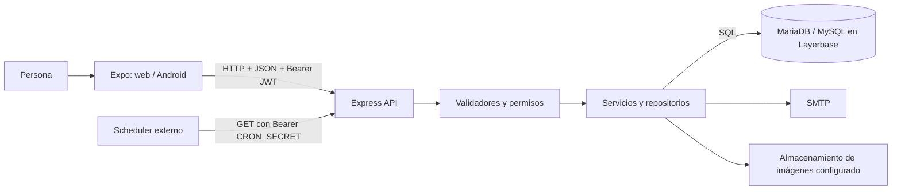

# Guía de estudio de PetCare

Guía basada en el checkout del repositorio. Los ejemplos usan cuentas y datos ficticios. Las rutas y nombres de código se pueden buscar desde la raíz del proyecto; los archivos enlazados son rutas relativas para que la guía siga funcionando al mover el repositorio.

## Recorrido sugerido

1. [El sistema de punta a punta](01-sistema.md)
2. [Tecnologías y vocabulario](02-tecnologias.md)
3. [Frontend y pantallas](03-frontend.md)
4. [Backend y API](04-backend.md)
5. [Base de datos y persistencia](05-base-de-datos.md)
6. [Correo, verificación e invitaciones](06-correo-invitaciones.md)
7. [Inicio de sesión, roles y seguridad](07-seguridad.md)
8. [Módulos funcionales](08-modulos.md)
9. [Notificaciones y tareas programadas](09-notificaciones.md)
10. [Despliegue web y APK](10-despliegue.md)
11. [Recorridos completos de operaciones](11-recorridos.md)
12. [Inventario de archivos y responsabilidades](12-inventario.md)
13. [Defensa oral: 50 preguntas](13-preguntas.md)
14. [Plan de estudio, discursos y repaso](14-estudio.md)
15. [Alcance de la revisión y temas por verificar](15-alcance.md)

## Cómo estudiar cada capítulo

Para cada concepto, seguí esta secuencia: qué significa, para qué sirve, cómo funciona, dónde se ve en PetCare, un ejemplo y una respuesta breve que puedas decir con tus palabras. Después abrí el archivo enlazado y localizá el símbolo citado. El objetivo no es memorizar rutas, sino reconstruir la cadena pantalla → API → reglas → base de datos → respuesta.

## Mapa general

## Límites de esta guía

El repositorio no contiene credenciales ni permite confirmar que los servicios remotos estén operativos. La base remota, la consola de Vercel/EAS y las consolas de OAuth/SMTP no se inspeccionaron. Por eso se distingue el código configurado del funcionamiento confirmado en producción. La guía describe el checkout presente, no certifica una instalación productiva.
