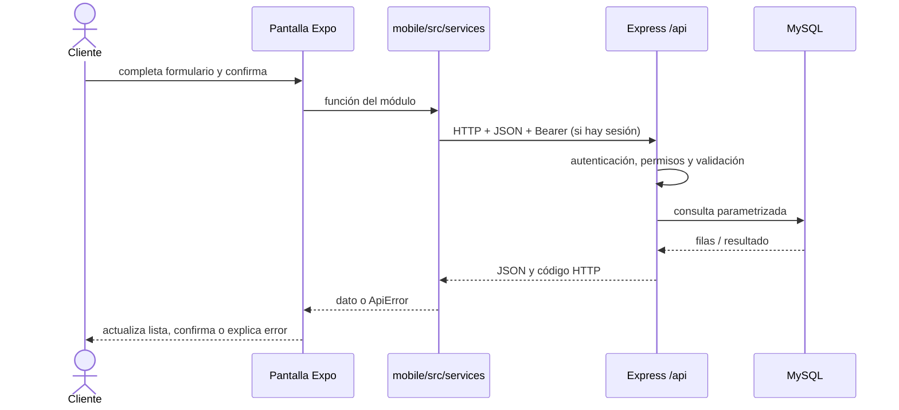

# 1. PetCare de punta a punta

## Qué es y qué problema resuelve

PetCare es una aplicación web y móvil para coordinar atención veterinaria, peluquería, turnos y servicios de una clínica. Reúne el trabajo que de otro modo quedaría repartido entre llamadas, planillas, fichas y mensajes: clientes pueden gestionar mascotas y turnos; el personal puede atender agenda y pacientes; administración configura usuarios, catálogo y tienda.

El repositorio define cinco roles: `CLIENT`, `VETERINARIAN`, `GROOMER`, `ADMIN` y `SUPER_ADMIN`. El rol describe una categoría de cuenta; los permisos efectivos concedidos a esa cuenta determinan las acciones permitidas. `GROOMER` cubre peluquería. `SECRETARY` aparece en algunos comentarios o rutas históricas, pero el código actual de identidad no lo acepta como rol vigente.

## Partes y responsabilidades

| Parte | Ubicación | Responsabilidad |
|---|---|---|
| Cliente web/Android | `mobile/src` | Pantallas, formularios, validaciones de experiencia, estado y navegación |
| API | `backend/src` | Identidad, autorización, reglas de negocio, validación y respuestas HTTP |
| Persistencia | Repositorios backend + MariaDB/MySQL | Usuarios, mascotas, turnos, clínica, notificaciones, tienda y registros |
| Servicios externos | Configuración backend | SMTP, OAuth de Google/Facebook/X y almacenamiento de imágenes compatible con Cloudinary/S3 |
| Publicación | `mobile/vercel.json`, `backend/vercel.json`, `mobile/eas.json` | Parámetros de build y despliegue |

“Frontend” es lo que ejecuta y muestra la interfaz al usuario. “Backend” es el servicio que recibe solicitudes, impone reglas y habla con la base. Una API (interfaz de programación de aplicaciones) es el contrato de solicitudes y respuestas que conecta ambos.

## Cómo se comunican

La app forma solicitudes HTTP. Para una sesión protegida agrega `Authorization: Bearer <access token>`. Los datos suelen viajar como JSON. El backend responde con una envoltura `{ success, data }`; los fallos usan un formato normalizado por el middleware de errores. La web además necesita CORS (regla del navegador que limita qué sitios pueden llamar a la API); Android nativo no depende de CORS.

## Ejemplo: iniciar sesión

1. `mobile/src/app/login.tsx` presenta el formulario; sus campos y botones son componentes React Native reutilizables.
2. La acción delega en `signIn` del contexto `mobile/src/contexts/AuthContext.tsx`.
3. `mobile/src/services/auth.service.ts` prepara la llamada a `POST /api/auth/login`; el cliente `apiRequest` de `mobile/src/services/api.ts` obtiene la URL, serializa JSON, establece timeout y traduce errores.
4. `backend/src/routes/auth.routes.ts` conecta esa ruta con `login` del controlador y aplica límite de intentos.
5. `backend/src/controllers/auth.controller.ts` delega en `loginUser` de `backend/src/services/auth.service.ts`.
6. El servicio valida forma de correo/contraseña, lee usuario, compara bcrypt y rechaza cuenta inactiva, contraseña incorrecta, correo sin verificar o contraseña inicial pendiente.
7. Si es válida, `sessionForUser` emite un JWT de acceso y un refresh token con familia persistida. El JWT identifica la cuenta, pero los permisos se vuelven a cargar desde la base en cada solicitud protegida.
8. El frontend llama también a `POST /api/auth/me`; solo después guarda access/refresh en SecureStore (Android) o `sessionStorage` (web) y actualiza el contexto.
9. `_layout.tsx` y los layouts por rol muestran el destino permitido.

Esta explicación está en el código; no implica que la API o SMTP remotos estén disponibles. Un error de red produce mensaje de conexión y no una sesión local inventada.

## Desarrollo y producción

En desarrollo, Expo puede derivar la dirección local del host de Metro o aceptar una URL de desarrollo HTTPS explícita. El backend escucha normalmente en puerto 3000 y usa DB local si se configura. En producción, el cliente tiene configurada una URL HTTPS fija y falla cerrado si la URL no coincide con la de producción esperada. Vercel sirve la web y la API como proyectos separados según su directorio raíz; EAS compila Android. Las variables privadas del backend no se deben incluir en `EXPO_PUBLIC_*`.

### Preguntas de defensa

- **Básica — ¿Qué hace PetCare?** Organiza atención de clínica y operaciones relacionadas para clientes y personal. Ejemplo: mascota, turno y ficha clínica. **En una frase:** “Es una aplicación web y Android con una API que conecta clientes, profesionales y administración.” **Repregunta:** ¿Qué problema resuelve?
- **Intermedia — ¿Cómo llega un turno a la base?** Pantalla → servicio móvil → ruta → controlador → servicio/reglas → repositorio → SQL. La respuesta vuelve en JSON. **En una frase:** “El móvil solicita; el backend verifica y persiste.” **Repregunta:** ¿Dónde se valida el permiso?
- **Avanzada — ¿Por qué no confiar en el rol que manda la app?** Un cliente puede modificar su propio programa; la API obtiene rol y permisos de fuentes del servidor. **En una frase:** “La interfaz orienta, el backend autoriza.” **Repregunta:** ¿Cómo se protege ownership de mascotas?
