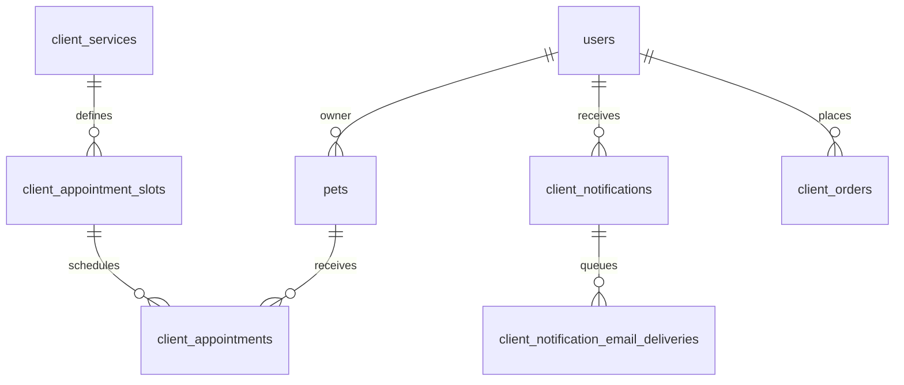

# 5. Base de datos desde cero

## Conceptos

Una base de datos es almacenamiento organizado que permite consultar y cambiar información. Una tabla se parece a una hoja: columnas describen datos (`name`, `email`), filas son registros. Una clave primaria identifica una fila; una clave foránea referencia otra tabla. Una relación enlaza registros: una cuenta puede tener varias mascotas, cada mascota puede tener varios turnos.

SQL es el lenguaje de consulta. `SELECT` lee, `INSERT` crea, `UPDATE` modifica, `DELETE` elimina. CRUD nombra Create, Read, Update, Delete (crear, leer, actualizar, borrar). Un `JOIN` combina filas relacionadas; un índice acelera ciertas búsquedas a cambio de costo adicional al escribir; una restricción protege reglas como unicidad, no-nulo o referencias. Una transacción agrupa pasos: todos confirman juntos o se revierten juntos.

## Esquema observado

El checkout usa `mysql2/promise` y documentación lo identifica como MariaDB/MySQL alojado en Layerbase. El SQL está disperso entre repositorios, migraciones y scripts; no hay un archivo canónico completo de esquema limpio. Migraciones visibles hacen cambios para mascotas/fotos, clínica, disponibilidad, fichas clínicas, órdenes y auditorías, entre otros. Informes `schema-audit.json` y `layerbase-sql-audit.json` son auditorías/artefactos, no garantía de que esquema remoto actual coincida.

Tablas citadas por SQL actual incluyen `users`, `roles`, `permissions`, `permission_modules`, `user_permissions`, `pets`, `client_appointments`, `client_appointment_slots`, `client_services`, `specialties`, `veterinarians`, `veterinarian_patients`, `client_clinical_records`, `client_notifications`, `client_notification_email_deliveries`, `client_products`, `client_orders`, `client_order_status_history`, `veterinarian_invitations`, `email_verifications`, `password_resets`, `oauth_accounts`, `sessions`/familias de sesión y tablas de direcciones/pagos. Columnas exactas varían por migración/instalación; consultar solo lectura en el entorno sería requisito para fijar el esquema de producción.



El diagrama expresa relaciones deducidas de consultas reales del backend, no sustituye un diagrama introspectado del servidor remoto.

## SQL de ejemplo basado en patrones reales

```sql
SELECT CAST(a.id AS CHAR) AS id, p.name AS petName, s.starts_at
FROM client_appointments a
JOIN pets p ON p.id = a.pet_id
JOIN client_appointment_slots s ON s.id = a.slot_id
WHERE a.owner_id = ? AND a.id = ?;
```

Las uniones traen turno, mascota y horario; placeholders `?` reciben valores con `execute(sql,[ownerId,appointmentId])`. El ownership se limita por `owner_id`, no por un ID que la app pueda falsificar.

## Eliminación y migraciones

El borrado de usuarios administrativo es lógico: `is_active=0`, registra actor/acción, conserva historial y eleva `session_version`. Esto impide acceso y revoca tokens anteriores. Hay operaciones de borrado físico en recursos específicos, por ejemplo especialidad solo si no hay referencias; disponibilidad puede archivarse para conservar fila/historial. “Desactivar” y “eliminar” no significan lo mismo en todos los módulos.

Una migración es un cambio controlado del esquema. Scripts `db:migrate*`, bootstrap, seed y administración pueden alterar datos. La documentación del backend avisa que no se ejecute sin confirmar entorno/procedimiento y que el checkout carece del SQL canónico para base vacía. La guía no los ejecutó.

### Preguntas de defensa

- **Básica — ¿Qué es clave foránea?** Columna que referencia la clave de otra tabla. **Ejemplo:** `pet_id` de turno apunta a mascota. **Corta:** “Mantiene la conexión entre registros.” **Repregunta:** ¿Qué evita una FK?
- **Intermedia — ¿Qué aporta una transacción?** Agrupa modificaciones coherentes. **Ejemplo:** aceptar invitación cambia usuario y consume token en un solo commit. **Corta:** “O quedan todos los cambios, o ninguno.” **Repregunta:** ¿Qué hace rollback?
- **Avanzada — ¿Por qué baja lógica?** Conserva historial/auditoría y revoca acceso sin romper referencias. **Corta:** “Desactivo la cuenta y preservo sus datos históricos.” **Repregunta:** ¿Qué datos remotos verificaste?
