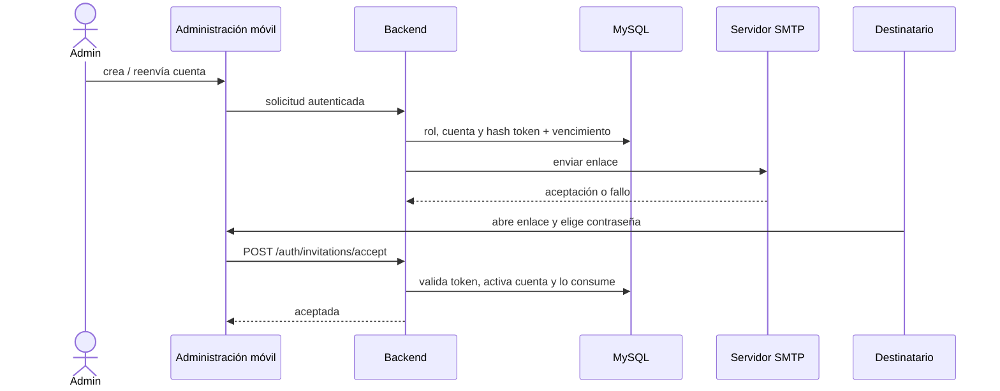

# 6. Correo, verificación e invitaciones

## Qué es SMTP y qué evidencia hay

SMTP significa **Simple Mail Transfer Protocol**, protocolo simple de transferencia de correo. La aplicación se conecta a un servidor SMTP (host y puerto), negocia conexión protegida con TLS/SSL según configuración, y solicita que acepte un mensaje con remitente/destinatario/asunto/cuerpo. Nodemailer crea el cliente SMTP. `SMTP_HOST`, `SMTP_PORT`, `SMTP_SECURE`, `SMTP_REQUIRE_TLS`, `SMTP_USER`, `SMTP_PASSWORD`, `MAIL_FROM` son nombres de configuración; no se documentan aquí sus valores secretos. El servidor SMTP, dominio y buzón real no se verificaron en este checkout.

Aceptar un mensaje por SMTP no prueba que llegue a Inbox: el proveedor puede rechazar, filtrar como spam o diferir la entrega. El código detecta rechazo/exception; no puede confirmar lectura humana.

## Invitación: ciclo real

1. Administración crea una cuenta profesional o reenvía invitación desde pantallas de administración. Rutas administrativas están en `mobile/src/app/admin/*`; envío/creación se conecta con servicios `admin.service.ts` o `clinic.service.ts` según pantalla.
2. Backend valida el rol/permiso y datos. La creación de veterinario está en `backend/src/routes/veterinarian.routes.ts`; la invitación general de cuenta se invoca desde admin repository.
3. `backend/src/services/invitation.service.ts` genera 32 bytes aleatorios (256 bits), almacena el SHA-256 del token (no token original) con expiración 24 h y estado `pending`. Renovar rota el token, aplica enfriamiento de 60 segundos y usa transacción/locks.
4. `invitationUrl` construye URL del frontend público. `deliverInvitation` crea enlace y llama `sendInvitationEmail` en `mail.service.ts` vía Nodemailer.
5. El correo contiene texto y HTML. El link abre activación en móvil/web; el token se procesa localmente y se manda al endpoint `POST /api/auth/invitations/accept`.
6. `acceptInvitation` valida forma, hashea nueva contraseña con bcrypt, busca hash del token con lock, revisa vigencia/no consumido/rol/estado, activa cuenta, verifica email, quita obligación de cambio inicial, incrementa versión de sesión, consume invitación y elimina verificaciones previas; todo dentro de transacción.
7. Al concluir, el usuario inicia sesión. El token de invitación no es JWT de acceso; solo autoriza ese paso.

Si SMTP falla al entregar, `deliverInvitation` guarda `delivery='failed'`; invitación sigue con token vigente hasta caducidad o rotación. Token inválido/vencido/usado se rechaza genéricamente. Reenvío genera token nuevo; enlace anterior deja de coincidir. No se debe decir “se reintenta automáticamente” para esta ruta: no hay cola general de reintento de invitación observada.

## Otros mensajes y diferencias

| Mensaje | Token/código y vencimiento | Ruta del código |
|---|---|---|
| Verificación de email | Código de 6 dígitos; vence a 10 min; token de prueba dura 24 h; límite de intentos/envíos | `verification.service.ts` + `mail.service.ts` |
| Invitación | Token aleatorio 256 bits; hash SHA-256, 24 h, un uso | `invitation.service.ts` |
| Recuperación | Token aleatorio 256 bits, hash en DB, 30 min y un uso | `password-reset.service.ts` |
| Recordatorio | Mensaje interno persistido y entrega de email en cola separada | `notifications.service.ts` |

Verificación reserva código/hash antes de SMTP, cooldown 45 s, máximo cinco envíos por ventana y máximo cinco intentos de código; fallos de correo consumen cuota para evitar abuso. El código no queda en logs. Reset de contraseña responde de forma que no revele si una cuenta existe y revoca sesiones con `session_version` al completarse.

### Preguntas de defensa

- **Básica — ¿Qué hace SMTP?** Transporta un mensaje al servidor de correo configurado. **Ejemplo:** `sendInvitationEmail`. **Corta:** “El backend entrega por SMTP el email de activación.” **Repregunta:** ¿Prueba que llegó a Inbox?
- **Intermedia — ¿Por qué guardar hash del token?** Si se filtra la DB no queda el enlace utilizable. **Ejemplo:** SHA-256 en `veterinarian_invitations`. **Corta:** “Se guarda prueba derivada; el enlace bruto solo se envía al destinatario.” **Repregunta:** ¿Cómo se invalida al reenviar?
- **Avanzada — ¿Qué garantiza transacción de aceptación?** Consumo y activación ocurren juntos, evitando uso doble parcial. **Corta:** “Token de un uso, bloqueado y consumido al activar.” **Repregunta:** ¿Qué no puede garantizar el SMTP?
